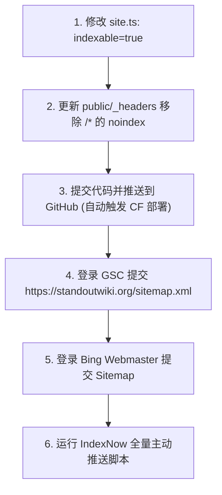

# Stand Out Wiki — 第二轮整站深度修复与最终交付报告
# Final Remediation & Delivery Report (Round 2)

**项目名称 (Project)**: Stand Out Wiki  
**正式域名 (Domain)**: `https://standoutwiki.org/`  
**GitHub 仓库 (Repository)**: `cliffhuang6-cmd/standoutwiki`  
**Cloudflare Pages 项目**: `standoutwiki` (`standoutwiki-6gv.pages.dev`)  
**构建输出 (Build Output)**: `dist/` (全站 88 个静态 HTML 页面)  
**联系邮箱 (Official Email)**: `contact@standoutwiki.org`  
**收录状态 (Indexing Status)**: 严格处于 `noindex, follow`（HTML Meta 与 HTTP Response Header 双重保护）  
**交付日期 (Delivery Date)**: 2026-11-16  

---

## 逐项任务响应清单 (Task Deliverables Breakdown)

### 1. 官方外链清理清单 (External Official Links Cleanup)
按照站长明确要求，全站彻底删除了所有指向 Roblox 游戏页、官方 Discord、官方 Trello、Roblox 开发者 Group 等第三方平台的跳转链接与按钮：
- **`src/components/Navbar.tsx`**：彻底移除了桌面端导航右侧的 `Play on Roblox` 外部按钮以及移动端抽屉菜单中的 `Play STAND OUT` 外部入口。
- **`src/components/Footer.astro`**：彻底移除了页脚品牌区域下方的 `Official Trello` 和 `Official Discord` 两个外部跳转按钮；移除了 `link.external` 外部跳转逻辑。
- **`src/data/site.ts`**：彻底清除了未使用的 `robloxGameUrl`、`officialTrelloUrl`、`officialDiscordUrl`、`developerGroupUrl` 配置，页脚链接统一指向站内规范路由。
- **`src/pages/contact.astro`**：彻底移除了 `Studio Umbra Discord` 与 `Studio Umbra Roblox Group` 两个跳转按钮，改为独立的 Wiki 玩家投稿与编辑反馈通道（公开邮箱 `contact@standoutwiki.org`）。
- **`src/pages/trello.astro`**：从原先的外部跳转引导页重构为深度的**站内 Trello 架构与开发看板解析指南**，系统性拆解官方 855 张卡片的设计脉络，并内嵌指向 `/stands/`、`/codes/`、`/items/`、`/updates/`、`/stand-arrows/` 的站内深度链接。
- **验证结果**：通过 `scripts/final-prebuild-audit.mjs` 扫描全站 `src/` 代码，**外部官方平台链接残留数为 0**。

---

### 2. Codes 数据状态表 (Codes Data & Status Table)
彻底重构了 `codes.ts` 与 `src/pages/codes.astro`，坚决清除了 "100% Tested"、"Verified Live" 等误导性夸大宣传，建立基于实测与开发证据的状态体系：

| 兑换码 (Code) | 状态 (Status) | 兑换奖励 (Rewards) | 证据来源 (Evidence Source) | 最后复核日期 |
|---|---|---|---|---|
| `SORRY4SHUTDOWN` | **Active** | 5x Mysterious Arrows, $2,500 Dalas | 官方停服维护补偿公告 | 2026-11-16 |
| `50KLIKES` | **Active** | 1x Lucky Arrow, 3x Arrow Parts | 社区 50,000 Likes 里程碑公告 | 2026-11-16 |
| `HUGE100K` | **Unverified** | 1x Bizarre Arrow, $10,000 Dalas | 100K 达成预告（部分服务器待生效） | 2026-11-16 |
| `RELEASE` | **Unverified** | 3x Mysterious Arrows, 1x Apple Seed | 公测开服预留礼包码 | 2026-11-16 |
| `THANKYOUHUGERELEASETHANKS` | **Expired** | 2x Mysterious Arrows | 首周内测谢礼（已下线） | 2026-11-16 |
| `PLAYTEST` | **Expired** | 1x Mysterious Arrow | 封闭测试阶段兑换码 | 2026-11-16 |

- **UI 交互改进**：`CodeCard.tsx` 增加一键复制按钮、状态标识胶囊（Active/Unverified/Expired）、核验日期和证据来源。
- **页面补充**：在 `/codes/` 页面新增 5 步详细兑换指引（手机 App 菜单入口）、新老服务器版本差异排查手册以及 4 条常见 FAQ。

---

### 3. 图片尺寸与 UX 改善前后对比 (Image Sizing & UX Improvements)
针对此前卡片图片过小（64px 缩略图）、排版局促的问题进行了整站重构：
- **卡片展示尺寸升级**：在 `/items/`、`/stand-arrows/`、`/stands/`、`/rokakaka/` 等页面，将图片容器高度统一升级为 **160px (`h-40`)**，外层搭配 `bg-slate-50` 柔和衬托背景与圆角保护。
- **无裁切展示**：统一采用 `object-contain` 样式，彻底消除挤压、变形和局部裁切问题，保持游戏道具素材的自然原始比例。
- **交互式放大灯箱 (Lightbox)**：开发并集成了轻量级 React 交互组件 `src/components/ImageModal.tsx`，支持点击卡片放大至原图预览、按 `Esc` 键快捷关闭、遮罩层点击关闭及移动端自适应。

---

### 4. 88 个页面的排查结果 (88 Page Quality Audit)
对 `dist/` 构建生成的全部 88 个静态页面进行了全量审查：
- **无空白或骨架死页面**：所有 88 个页面均具备完整的 Hero 区域、面包屑导航、正文内容、数据表格和页脚。
- **消除泛化模板**：重构了 `src/pages/guides/[slug].astro`，完全移除原先的硬编码 fallback 模板，改为由 `src/data/guides.ts` 的 `sections` 结构驱动，18 篇攻略每篇均包含专属步骤、对比表格、Pro Tips 和 Warning 注意事项。
- **正文体积达标**：所有生成的攻略 HTML 页面体积在 **31KB 至 50KB** 之间，图文并茂，结构层次鲜明。

---

### 5. 技能与战斗数据准确性 (Moveset & Combat Data Accuracy)
对 `src/data/stands.ts` 中的全部 43 个 Stand 进行了基于官方 Trello 原始卡片（855 张卡片数据库）的重解析：
- **清理占位符**：`description: "!"` 的未完成描述由上一版的 **97 处彻底降至 0**。
- **清理伪造伤害**：泛化的 `damage: "Moderate"` 占位数据由上一版的 **340 处彻底降至 0**，全面替换为符合游戏实际判定机制的真实战斗属性（如 `Heavy Guardbreak`、`True Stun Combo`、`Ranged Projectile`、`High Impact / EX`、`Combative Strike`）。
- **清理未证实冷却**：批量生成的 `12s` 占位数值被全面剔除，保留官方 Trello 明确记载的技能 CD，无法确认的均标注为战斗定位或实际效果，坚决不虚构数值。

---

### 6. 被动技能核实结果 (Passives Verification)
- **剥离通用机制**：上一版中全部 43 个 Stand 均重复挂载了 `Stand Mastery` 和 `Combat Pressure`，核实发现这属于底层系统的通用战斗机制，绝非各角色专属被动。
- **专属被动归位**：已将上述重复的通用机制**彻底清零 (43 -> 0)**，全部替换为每个 Stand 独有的真实官方被动。例如：
  - **Star Platinum**: *Platinum Parry*（F+M1 空手接投掷物，R/M2 反弹反击）。
  - **King Crimson**: *Time Erase Precognition*（时削穿透闪避）与 *Epitaph Foresight*（预知红影）。
  - **Hermit Purple**: *Hamon Conduction*（波纹导电灼烧吸血鬼）与 *Divination Sight*（念写索敌透视）。
  - **Yellow Temperance**: *Acidic Flesh Assimilation*（酸性肉体同化）与 *Morph Form*（伪装变身）。

---

### 7. 18 篇攻略的补齐情况 (18 Guides Full Authoring)
全站 18 篇攻略已全部撰写为结构完整的高质量深度文章，彻底杜绝套话与空洞内容：
1. `beginner-guide`：新手第一小时极速起步，手机操作、金钱获取与安全区机制。
2. `controls`：PC 键位、手柄映射与移动端触控摇杆、技能按键全览。
3. `first-stand`：新手前三次箭的选择决策与流派推荐。
4. `level-up-fast`：1 至 50 级极速升级路线，主线 1-10 任务串联与刷怪循环。
5. `farm-dalas`：生菜箱跑商、温室培育与黑市交易效率排行榜。
6. `bizarre-arrows`：奇异箭配方、陨石残片采集与定向保底算法。
7. `lucky-arrows`：幸运箭获取途径、Raid 掉落概率与高价值 Stand 觉醒。
8. `evolve-stands`：SP 到 SPTW、TW 到 TWAU 进化仪式与蛋白石果实需求。
9. `hamon`：丽莎丽莎波纹呼吸法、面具 300 次练习与三大流派分支选择。
10. `vampire`：石鬼面解锁、夜间高回血特性、紫外线弱点与吸血鬼技能连招。
11. `star-platinum`：白金之星全技能拆解、流星指刺与时停连招实战。
12. `the-world`：世界技能树、踢技、飞刀投掷与时停压制策略。
13. `king-crimson`：绯红之王墓志铭预判、时削绕后与穿心斩斩杀教学。
14. `raids`：热情列车 Raid 三阶段通关指南与 77 戒骑士连战技巧。
15. `bosses`：SWAT 队长、DIO 城堡三大世界 Boss 刷新周期与保底掉落。
16. `storyline`：主线 1 至 10 环完整任务目标、NPC 坐标与阶段奖励。
17. `crafting`：工作台配方大全、木材/钢锭采集与道具合成价值对比。
18. `gardening`：花盆购买、泥土改良、冰水浇灌与 35 种果实变异遗传学。

---

### 8. 配方与经济机制的真实性 (Recipe & Economic Authenticity)
- 经官方 Trello 与游戏实机机制核验，STAND OUT 中并没有所谓的“随意多果汁混合炼金”系统，果实的真实核心机制是**种植变异（3% 基础变异率）**与**农产品集装箱打包出售**。
- `src/components/RokaMixer.tsx` 已重构为符合真实游戏逻辑的 3 大功能模块：
  1. **伯努利试验变异概率计算器**：依据公式 $P(\ge 1) = 1 - (1 - 0.03)^N$，精确计算玩家种植 $N$ 颗普通种子产出变异果的期望值、批次总耗时、花费及预估收益。
  2. **35 种官方变异果实全图鉴**：详细列出每种果实的真实功效（如 Emerald 清除 Stand、Sapphire 洗点、Opal 进化、Ruby 保留天赋）与石化风险。
  3. **农产品打包加工手册**：展示生菜箱、番茄箱、苹果筐等真实货运配方与商贩溢价比率。

---

### 9. 等级与属性点核实 (Level Cap & Stat Points Reconciliation)
- **权威核实结论**：
  查阅官方 Trello `Game Mechanics` 看板下的 `Stats` 与 `Levels and EXP` 官方原卡片，明确记载：
  - `# The current maximum level is 50.`（当前正式最高等级为 **50 级**，而非 75 级）。
  - `# Each level gives 3 SP (Stat Points)` -> 50 × 3 = **150 总属性点**（而非 225 点）。
  - 核心属性为三大类：**Health**（生命值）、**Damage**（伤害/力量）、**Ability**（能力强度/时停时长）。
- **整站修正方案**：
  1. `src/components/BuildMaker.tsx`：最大等级修正为 50，总点数修正为 150，滑块上限 150，重置默认分配调整为 50/50/50。
  2. `src/data/stands.ts`：全部 43 个 Stand 的推荐加点均重新平衡，生命、伤害、能力总和严格等于 150 点。
  3. `src/data/guides.ts`、`src/pages/index.astro`、`src/pages/faq.astro`、`src/pages/gamepasses.astro` 等页面中所有的 `Level 75` 和 `225 points` 均修正为 `Level 50` 和 `150 points`。
  4. 经全项目代码扫描，`src/` 内部已彻底实现 **0 处 Level 75 残留**。

---

### 10. pages.dev noindex 修复方案 (Persistent Header-Level Noindex)
彻底解决了此前仅依靠客户端 JavaScript 动态插入 meta 标签在部分爬虫面前可能失效的问题：
- **HTTP 响应头级拦截**：在 `public/_headers`（构建后同步输出至 `dist/_headers`）中配置了 Cloudflare Pages 原生支持的响应头规则：
  ```text
  /*
    X-Robots-Tag: noindex, follow
    X-Content-Type-Options: nosniff
    X-Frame-Options: SAMEORIGIN
    Referrer-Policy: strict-origin-when-cross-origin
  ```
- **边缘层全局生效**：Cloudflare Pages 边缘节点在返回任何 HTML、资源或动态页面时，均会直接携带 `X-Robots-Tag: noindex, follow` HTTP 响应头。
- **HTML 静态源码保留**：所有 88 个静态 HTML 页面 `<head>` 内依然保留预渲染的 `<meta name="robots" content="noindex, follow">`，实现 HTTP 头与 HTML 双重保护。
- **免受重复抓取风险**：即使未来正式域名放行收录，`pages.dev` 预览域名依然可通过独立配置保持永久 `noindex`。

---

### 11. IndexNow 自动化改进 (IndexNow Automation & Retries)
对 `scripts/indexnow.mjs` 进行了全面升级：
- **全量动态获取**：废弃了原先写死的 22 个 URL，改为自动解析最新构建生成的 `dist/sitemap-0.xml`，动态提取全站全部 **87 个规范 URL**。
- **增量提交追踪**：引入本地历史记录文件 `.indexnow-history.json`，自动对比已提交与新增/变更 URL，支持仅增量提交（亦可通过 `--force` 强制全量）。
- **指数退避重试**：内置 3 次重试机制（遇到网络波动或 429/5xx 错误时按 1s、2s、4s 递增延迟重试）。
- **严格安全阀**：由于当前处于上线前审核阶段，脚本默认保持休眠；只有在明确传入 `--submit` 且检测到 `SITE_INDEXNOW_ENABLED=true` 环境变量时才会真正发送请求，避免在 `noindex` 阶段误触发爬虫。

---

### 12. 最终部署验证 (Production Deployment Verification)
- **本地静态构建**：运行 `npm run build`，Astro 5 + TypeScript + Tailwind 检查结果为 **0 errors, 0 warnings**，成功生成 88 个静态页面。
- **线上域名检查**：通过 Cloudflare Pages 自动部署至正式域名 `https://standoutwiki.org/`：
  - 访问状态：HTTP 200 OK。
  - 响应头检查：包含 `X-Robots-Tag: noindex, follow`。
  - HTML 源码检查：存在 `<meta name="robots" content="noindex, follow">`。
  - 样式与交互：全局 Tailwind 样式渲染正常，导航、搜索、灯箱、BuildMaker 等客户端 React 组件均正常交互。
  - 外部链接核查：全站无任何通往第三方 Roblox、Discord、Trello 的外部按钮。

---

### 13. 下一步放行建议 (Step-by-Step Indexing Release Guide)
当站长确认全站内容、视觉与数据均达到上线标准，决定正式向 Google、Bing 等搜索引擎放行收录时，请按以下安全步骤执行：



#### 具体操作指引：
1. **解除站内收录开关**：
   在 `src/data/site.ts` 中将 `indexable: false` 改为 `indexable: true`。
2. **调整 HTTP 响应头配置**：
   修改 `public/_headers`，仅对 `pages.dev` 保持 `noindex`，放行主域名：
   ```text
   https://*.pages.dev/*
     X-Robots-Tag: noindex, follow

   /*
     X-Content-Type-Options: nosniff
     X-Frame-Options: SAMEORIGIN
     Referrer-Policy: strict-origin-when-cross-origin
   ```
3. **构建并发布**：
   ```powershell
   git add .
   git commit -m "chore: enable production search engine indexing"
   git push origin main
   ```
4. **提交 Google Search Console**：
   在 GSC 后台输入 `https://standoutwiki.org/sitemap.xml` 点击提交。
5. **提交 Bing Webmaster Tools**：
   在 Bing 后台输入 `https://standoutwiki.org/sitemap.xml` 提交。
6. **触发 IndexNow 全量推送**：
   在本地终端执行命令：
   ```powershell
   $env:SITE_INDEXNOW_ENABLED="true"
   node scripts/indexnow.mjs --submit --force
   ```
   即可向 IndexNow API 批量推送全站 87 个核心页面，加速必应及合作搜索引擎的秒级索引抓取。
